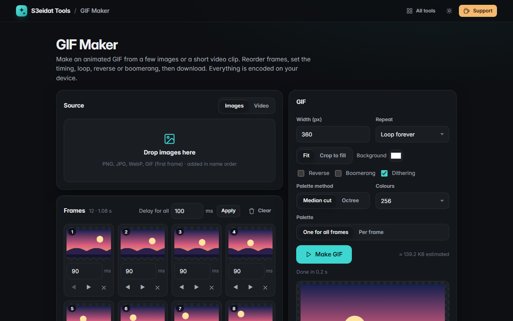

# GIF Maker

> Make animated GIFs from images or a video clip. Free, private, and it runs entirely in your browser.

### ▶ [Open GIF Maker](https://s3eidat.github.io/gif-maker/)



## Features

- **From images**: drop several pictures (sorted by name), **drag to reorder** (or use the arrow buttons),
  set a **delay per frame** or one delay for all
- **From video**: pick a **start and end time** and **frames per second** (up to 400 frames)
- **Resize** (width; height follows the first frame), **Fit** with a background colour or **Crop to fill**
- **Loop forever, play once, or a set number of times**
- **Reverse** and **Boomerang** (forwards then backwards)
- Our own **GIF89a encoder** (LZW), with **median cut** or **octree** colour quantisation, 16–256 colours,
  one shared palette or one **per frame**, and optional **Floyd–Steinberg dithering**
- Progress bar with cancel, live preview, size estimate before and real size after, download

## Privacy

Your images and videos never leave your device. There is no server, no account, no analytics.
The page ships with a strict Content-Security-Policy (`connect-src 'self'`), so the browser
itself blocks any attempt to send data anywhere.

## Run it yourself

It's plain HTML, CSS and JavaScript with no build step:

```bash
git clone https://github.com/s3eidat/gif-maker
cd gif-maker
python -m http.server 8000
```

Then open http://localhost:8000. The encoder lives in `gif.js` (`window.GifKit`) if you want to reuse it.

## Support

If this saved you time, **[buy me a coffee ☕](https://s3eidat.github.io/coffee/)**. It keeps every tool free.

---

Part of **[S3eidat Tools](https://s3eidat.github.io/)**: 100+ free, private tools that run in your browser. MIT licensed.
